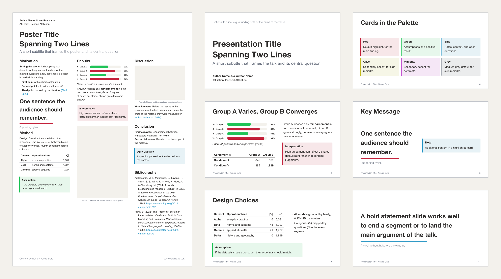

# Atomized Academic Typst Template Starters (aatts)

Atomized Academic Typst Template Starters (aatts): a clean 16:9 layout with a title slide, content slides, and a few components for cards, key statements, and simple bar charts. No dependencies beyond Typst itself.



## Getting started

```typ
#import "@preview/aatts:0.1.0": slides

#show: slides.theme.with(
  title: "Presentation Title",
  author: "Author Name",
  footer: [Presentation Title · Venue, Date],
)

#(slides.slide.title)(
  [Presentation Title],
  subtitle: [A short subtitle that frames the talk],
  meta-bot: [*Author Name* \ Affiliation],
)

#(slides.slide.base)(title: [Overview])[
  - First point
  - Second point
]
```

## Fonts

The default font stack is `Helvetica Neue, Helvetica, Arial, Liberation Sans`; the first installed family is used. To use a different font, pass `font` to `theme`:

```typ
#show: slides.theme.with(font: "Inter")
```

## Theme

`theme` sets the page format, text, headings, lists, tables, figures, footnotes, and links. Apply it once with a show rule.

| Parameter   | Default              | Description                                        |
|-------------|----------------------|----------------------------------------------------|
| `title`     | `none`               | Document title (PDF metadata).                     |
| `author`    | `()`                 | Author name or array of names (PDF metadata).      |
| `date`      | `auto`               | Document date (PDF metadata).                      |
| `font`      | see [Fonts](#fonts)  | Font family or array of fallback families.         |
| `lang`      | `"en"`               | Text language.                                     |
| `footer`    | `none`               | Content shown bottom left, next to the page number.|
| `highlight` | `palette.red`        | Accent colour for list markers.                    |

## `slides`

### `slide.title`

```typ
#(slides.slide.title)(
  [Presentation Title],
  subtitle: [Optional subtitle],
  meta-top: [Optional content at the top, e.g. event name],
  meta-bot: [Optional content at the bottom, e.g. author and affiliation],
)
```

### `slide.base`

Content slide with margins, footer, and an optional title. The body is vertically centred.

```typ
#(slides.slide.base)(title: [Slide title])[
  Content
]
```

### `slide.empty`

```typ
#(slides.slide.empty)[
  #image("photo.jpg", width: 100%, height: 100%, fit: "cover")
]
```

## `poster`

```typ
#import "@preview/aatts:0.1.0": poster

#show: poster.theme.with(
  title: [Poster Title],
  subtitle: [A short subtitle that frames the poster],
  author: "Author Name",
  meta-top: [*Author Name* \ Affiliation],
  meta-bot: [Conference Name · Venue, Date],
)

== Motivation

#poster.widgets.card(title: [Note])[
  The widgets of the slides, scaled to the poster.
]
```

| Parameter   | Default              | Description                                        |
|-------------|----------------------|----------------------------------------------------|
| `title`     | `none`               | Title, shown on the sheet and set as PDF metadata. |
| `subtitle`  | `none`               | Shown below the title.                             |
| `author`    | `()`                 | Author name or array of names (PDF metadata).      |
| `date`      | `auto`               | Document date (PDF metadata).                      |
| `meta-top`  | `none`               | Content above the title, e.g. authors.             |
| `meta-bot`  | `none`               | Content at the bottom of the sheet, e.g. venue.    |
| `columns`   | `3`                  | Number of body columns.                            |
| `paper`     | `"a0"`               | Paper size.                                        |


## Components

### `card`

Tinted box with a coloured bar on the left.

```typ
#slides.widgets.card(title: [Note], highlight: palette.blue, width: span.p12)[
  Additional context in a highlighted card.
]
```

### `statement`

Large bold statement with an accent line and an optional byline.

```typ
#slides.widgets.statement(byline: [Supporting byline])[
  One sentence the audience should remember.
]
```

### `bar-chart`

Takes one array per row: label, share between 0 and 1, colour, and the value shown on the right.

```typ
#slides.widgets.bar-chart(
  ([Group A], 0.72, palette.red, [72 %]),
  ([Group B], 0.45, palette.blue, [45 %]),
  ([Group C], 0.18, palette.green, [18 %]),
)
```

## Design System

The following dictionaries are exported so that custom content matches the design. 

| Name      | Keys                                       | Values                                    |
|-----------|--------------------------------------------|-------------------------------------------|
| `palette` | `red`, `green`, `blue`, `olive`, `magenta` | Accent colours.                           |
| `grey`    | `dark`, `medium`, `light`                  | Text, secondary text, background grey.    |
| `span`    | `p1` … `p25`                               | Widths on a 25-column grid; `p25` = 100 %.|


Span, size, and space derive from `base-unit-grid` (12), `base-unit-space` (1.6cm), and `base-unit-text` (16pt) are the constants these tokens are derived from.

| Name      | Keys                                       | Values                                    |
|-----------|--------------------------------------------|-------------------------------------------|
| `size`    | `xxl`, `xl`, `lg`, `base`, `sm`            | Text sizes: 48, 36, 24, 16, 12 pt.        |
| `space`   | `base`, `md`, `sm`, `xs`                   | Spacing: 1.6, 0.8, 0.4, 0.2 cm.           |
| `weight`  | `xl`, `lg`, `base`, `sm`                   | Line widths: 4, 2, 1, 0.5 pt.             |
